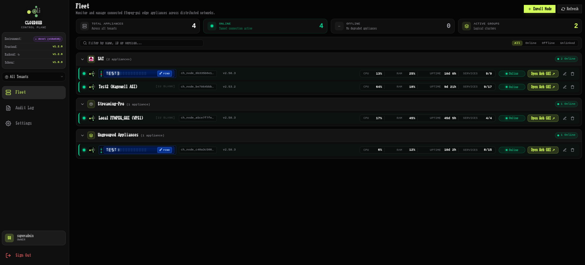
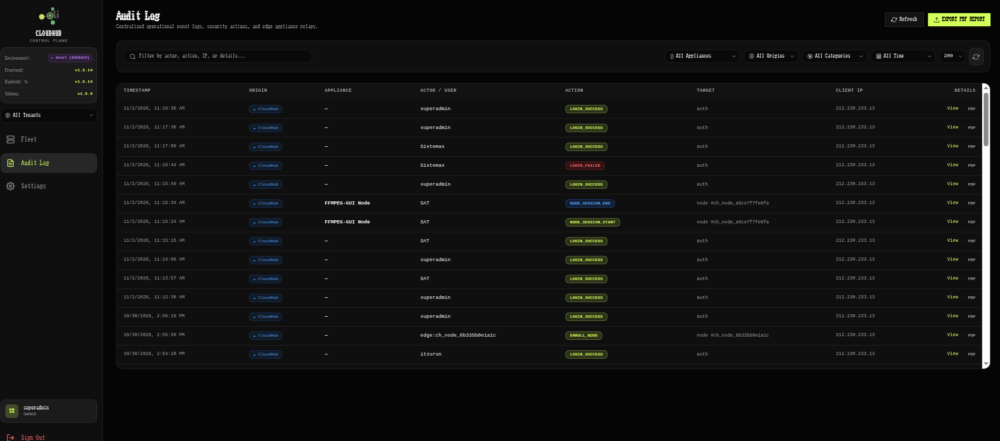
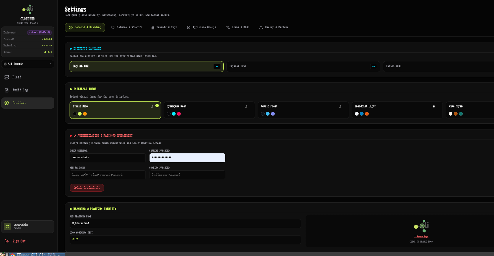

# ffmpeg-gui-cloudhub

[](https://opensource.org/licenses/MIT)
[](https://github.com/alexolivan/ffmpeg-gui-cloudhub)
[](https://www.python.org/)
[](https://fastapi.tiangolo.com)
[](https://react.dev)

A multi-tenant reverse tunnel bastion, fleet directory, and centralized telemetry control plane for [ffmpeg-gui](https://github.com/alexolivan/ffmpeg-gui) appliances.



---

## Overview

In professional broadcast, live production, and remote transmission environments, `ffmpeg-gui` appliances often run behind cellular 4G/5G uplinks, Carrier-Grade NAT (CGNAT), corporate firewalls, or isolated venue networks. In such topologies, exposing inbound ports or maintaining complex site-to-site VPN meshes is often impractical or forbidden.

`ffmpeg-gui-cloudhub` solves this problem by acting as a lightweight, zero-knowledge reverse tunnel bastion:
- **Outbound-only connection**: Edge appliances establish a persistent, multiplexed WebSocket connection out to CloudHub over standard HTTPS/WSS (`443/tcp`).
- **Zero inbound ports**: The edge machine requires zero port forwarding, zero static public IPs, and zero firewall modifications.
- **One-click native dashboard access**: Operators monitor the entire fleet from a single directory and open any remote appliance's native Web UI in an isolated browser tab with a single click.
- **Zero-knowledge security**: CloudHub never receives, stores, or handles the local administrator passwords of edge nodes.

---

## Core Capabilities

### 🌐 1. Outbound Reverse Tunnels & Firewall Traversal
- **Outbound-Only Multiplexing**: Edge appliances initiate and maintain persistent WebSocket connections (`/api/edge/tunnel`) over TLS.
- **Resilient Reconnection**: Built-in exponential backoff, keepalive pings, and dual handshake authentication (supporting both HTTP request headers and URL query parameter fallbacks for compatibility across CDNs and reverse proxies).
- **In-Memory Streaming**: Low-latency multiplexing for HTTP requests, server-sent events, and real-time interactive controls.

### 🔑 2. Zero-Knowledge Ephemeral SSO & Tab Isolation
- **Short-Lived Signed Assertions**: Single Sign-On relies on ephemeral HMAC-SHA256 tokens (60-second validity window) signed with the edge appliance's unique tunnel secret.
- **Local Edge Validation**: The edge node verifies the cryptographic signature locally and issues an isolated, session-scoped token directly in memory.
- **Single-Domain Multi-Tab Isolation**: Distinct cookie namespacing and path rewrites allow operators to open multiple remote appliances side-by-side in separate browser tabs without session collisions.

### 📊 3. Real-Time Fleet Vitality & Telemetry
- **Continuous Vitality Stream**: Connected edge appliances stream CPU, RAM, disk usage, uptime, service statuses (running vs. error), and active versions every 5 seconds.
- **Visual Health Indicators**: Instant classification into `Online`, `Degraded` (high system load or service errors), or `Offline` states.
- **Upstream Version Intelligence**: Automatically checks GitHub releases to alert operators when firmware or software updates are available for enrolled appliances.



### 📋 4. Centralized Audit Logging & PDF Reports
- **Complete Operational Traceability**: Centralizes security events across CloudHub and connected edge appliances (login successes/failures, user management, appliance enrollments, configuration backups, and edge session launches).
- **Granular Multi-Filter Console**: Search and filter records by actor, appliance, origin, action category, or date range.
- **Compliance PDF Reports**: Generates formal, branded audit log export reports (via ReportLab) with platform logo/monogram headers, filter summaries, and chronological event logs.

### 🏢 5. Multi-Tenant Governance & Hierarchical RBAC
- **Three Governance Tiers**:
  - **Platform Superadmin (Owner)**: Full platform ownership, tenant lifecycle, global fleet directory or tenant-filtered view, platform branding, and network/SSL settings.
  - **Tenant Administrator**: Scoped control over their assigned organization's users, appliances, and logical groups.
  - **Group Operator**: Restricted strictly to assigned appliance groups (e.g., *Studio 1*, *Mobile Unit*), with zero access to administrative settings or audit logs.
- **UNIX-Style Seed Prefixes**: Tenant seeds (`slug`) provide strict namespace separation (`[slug]_operator`), preventing cross-tenant username collisions while allowing intuitive, familiar naming.
- **Cascade Renaming**: Superadmin changes to a tenant seed automatically propagate to associated user logins with collision validation.



### 🎨 6. White-Label Branding, 5 Themes & Multi-Language
- **Custom Visual Branding**: Upload custom logo images (PNG, SVG, JPG, WebP) or set custom monogram badges for the platform and individual tenants.
- **5 Adaptive Themes**: Full theme parity with `ffmpeg-gui`, supporting `Studio Dark`, `Cyberpunk Neon`, `Nordic Frost`, `Broadcast Light`, and `Warm Paper`.
- **Full Internationalization (i18n)**: Seamless language switching between English, Spanish (`Español`), and Catalan (`Català`).

### 💾 7. Backup, Disaster Recovery & Rescue CLI
- **Scoped Backups**: Export full system configurations or tenant-specific snapshots for migration or disaster recovery.
- **Offline Rescue CLI**: Dedicated binary (`bin/ffmpeg-gui-cloudhub-admin`) to reset administrator credentials, clear rate-limiting lockouts, or inspect system state directly from the server shell.

---

## Architecture

```
                    ┌─────────────────────────────────────────┐
                    │          ffmpeg-gui-cloudhub            │
                    │   (Reverse Tunnel Bastion / Directory)  │
                    │       Single Domain / Let's Encrypt     │
                    └───────────────▲─────────────────────────┘
                                    │
                   Multiplexed WSS  │  Outbound Only (Port 443)
                   Reverse Tunnel   │  Zero Port Forwarding
                                    │
       ┌────────────────────────────┼────────────────────────────┐
       │ Behind CGNAT / 4G / NAT    │ Behind Corporate Firewall  │ Behind Local NAT
       ▼                            ▼                            ▼
  ┌──────────────────┐         ┌──────────────────┐         ┌──────────────────┐
  │  ffmpeg-gui node │         │  ffmpeg-gui node │         │  ffmpeg-gui node │
  │   (Master Master)│         │   (Transmitter)  │         │   (Mobile OB Van)│
  └──────────────────┘         └──────────────────┘         └──────────────────┘
```

---

## Quickstart

### Server Prerequisites
- **Operating System:** Debian 12 (Bookworm) or Ubuntu 22.04 / 24.04 LTS
- **Python:** 3.10+
- **Node.js:** 18+ and `npm`
- **Network:** Inbound port `443/tcp` (HTTPS/WSS) and `80/tcp` (HTTP/ACME challenges)

### Automated Installation
```bash
git clone https://github.com/alexolivan/ffmpeg-gui-cloudhub.git
cd ffmpeg-gui-cloudhub
./install.sh -y
```

For complete step-by-step instructions, Nginx reverse proxy configuration, systemd service management, and SSL setup, refer to the [Installation Guide](INSTALL.md).

---

## Appliance Pairing Ceremony

1. In the CloudHub Web UI, navigate to **Fleet** and click **Enroll Appliance**.
2. Select the target tenant and optional group, then click **Generate Token**.
3. On the edge appliance terminal, run the generated command:
   ```bash
   ./bin/ffmpeg-gui-admin enroll-cloudhub https://hub.example.com <ENROLLMENT_TOKEN>
   ```
4. The appliance pairs instantly, stores credentials in its local database, and establishes the persistent reverse tunnel.

---

## Admin Rescue CLI

An emergency offline CLI is provided for server administrators:

```bash
# Show version and system status
./bin/ffmpeg-gui-cloudhub-admin show-version

# Reset superadmin password
./bin/ffmpeg-gui-cloudhub-admin reset-admin-password --user admin --password "NewSecurePassword123"

# Create a new emergency superadmin account
./bin/ffmpeg-gui-cloudhub-admin create-superadmin --user rescue_admin --password "EmergencySecret456"

# Clear IP lockouts from failed login attempts
./bin/ffmpeg-gui-cloudhub-admin unlock-ips
```

---

## Running the Test Suite

CloudHub includes an automated test suite covering API endpoints, reverse tunnel multiplexing, RBAC policies, and audit logging:

```bash
PYTHONPATH=. python3 -m unittest discover -s backend/tests
```

Build the frontend production bundle:
```bash
cd frontend && npm run build
```

---

## License

This project is licensed under the [MIT License](LICENSE).
